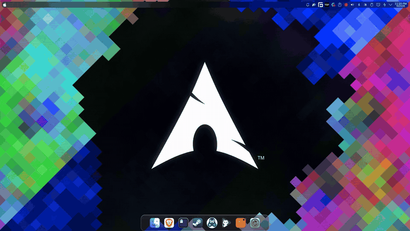
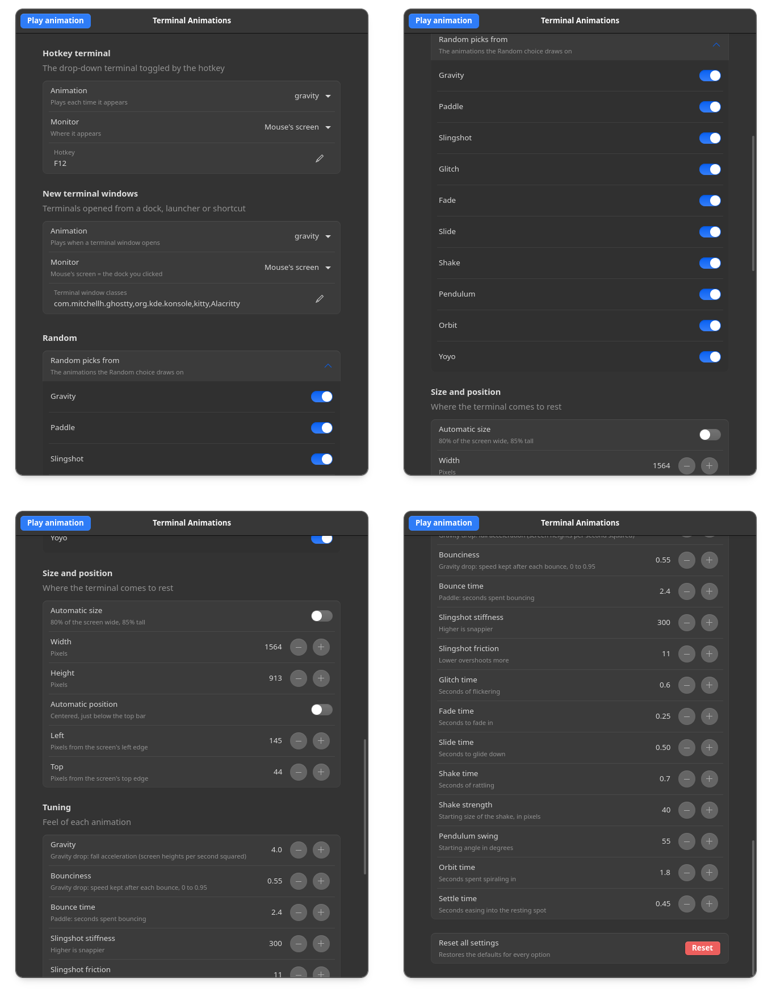

# termanim

Animated terminals for KDE Plasma (Wayland). Terminal windows fall, bounce, slingshot, glitch or fade into place instead of just appearing, and one hotkey summons a drop-down terminal with the same animations.



## Animations

| Name | What it does |
| --- | --- |
| `gravity` | Drops from above the screen, bounces on the floor, settles. |
| `paddle` | Ping-pongs around the screen like a paddle ball, then glides to its spot. |
| `slingshot` | Flies in from a random edge, overshoots, snaps back (a damped spring). |
| `glitch` | Flickers in and out with random jumps that shrink until it locks in. |
| `fade` | Fades in with a short upward slide. |
| `slide` | Glides down from the top edge and eases to a stop, like a classic drop-down terminal. |
| `shake` | Appears in place and rattles, settling as the shaking dies down. |
| `pendulum` | Swings in on an arc from above the screen, like a wrecking ball, and settles. |
| `orbit` | Spirals in from the edge of the screen, circling inward about one and a half times. |
| `yoyo` | Drops on a spring from above, falls past its spot, and bobs back to rest. |
| `random` | Picks from `randomPool`, never the same twice in a row. |

Each trigger has its own animation: **new terminal windows** (any app in `terminalClasses`, so launching Ghostty from a dock plays it) and the **hotkey terminal** (F12). Either can use the monitor your cursor is on, so clicking a dock icon on a screen makes the window arrive on that screen, or a fixed monitor.

## Requirements

- KDE Plasma 6 on Wayland (tested on Plasma 6.8, KWin 6.8)
- [Ghostty](https://ghostty.org) for the hotkey terminal. New-window animations work for any terminal listed in `terminalClasses`.
- `kwriteconfig6`, `kreadconfig6`, `qdbus6` (shipped with Plasma), Python 3
- For the settings window: PyGObject, GTK 4 and libadwaita (`python-gobject`, `gtk4`, `libadwaita` on Arch)

## Install

```sh
git clone https://github.com/metalmike17/termanim
cd termanim
./install.sh
```

Press **F12**. `./uninstall.sh` removes everything.

## Settings window

Open **Terminal Animations** from your app menu, or run `termanim-settings`. Changes apply as you make them, and **Play animation** previews the hotkey terminal.



The whole window, scrolled top to bottom.

It covers the animation and monitor for the hotkey terminal and for new windows, the hotkey, which window classes animate, the pool for random, size and position, and the tuning for each animation.

## Command line

Everything in the settings window is also available from the terminal.

Settings live in `~/.config/kwinrc` under `[Script-termanim]`. Use the `termanim` command:

```sh
termanim show                           # current settings
termanim keys                           # every setting, with a description
termanim set hotkeyAnimation slingshot
termanim set newWindowAnimation random
termanim set newWindowScreen DP-3       # always use one monitor (default: cursor)
termanim set width 1400                 # pixels; default is 80% of the screen
termanim reset                          # back to defaults
termanim test                           # play the hotkey animation
```

Other settings cover the hotkey, resting size and position, gravity strength and bounciness, spring stiffness, glitch length, and which window classes animate.

## How it works

A KWin script moves the window frame by frame (about 8 ms per tick) using Plasma's scripting API. New terminal windows are made fully transparent the moment they open and revealed once the animation starts, so they never show up at their default spot first. The hotkey terminal is a Ghostty window kept running in the background by a systemd user service, minimized until you press the hotkey. If it closes, systemd restarts it and the script keeps the replacement hidden.

## Limitations

- KDE Plasma only: it relies on KWin scripting.
- Animation is script-driven, so it is not GPU-smooth like KWin's built-in effects, and the glitch effect only moves and flickers the window (no tearing or slicing).
- A new window waits about 0.3 s before animating, because KWin ignores moves while a window is still opening.
- KWin caches a script's folder. If you edit the code, move `contents/vN` to `contents/vN+1` and update `X-Plasma-MainScript` in `metadata.json`; `termanim reload` follows that path. Changing settings does not need this.

## License

MIT
